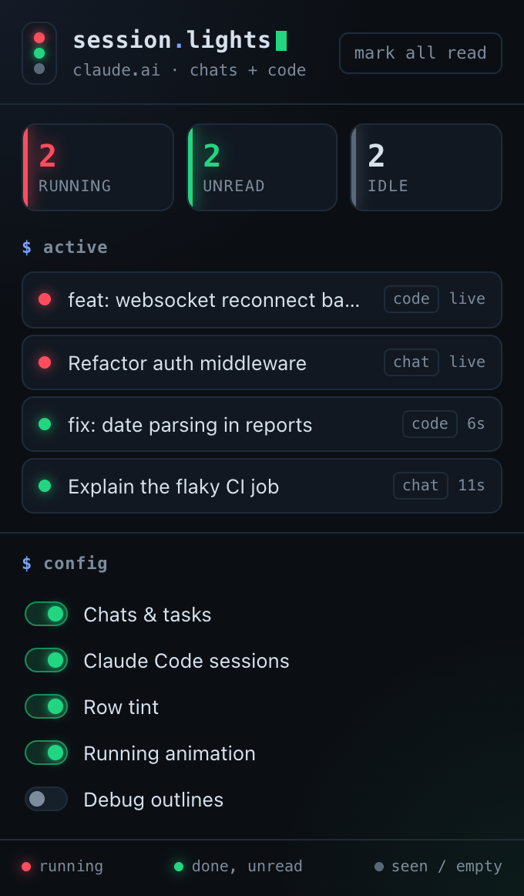
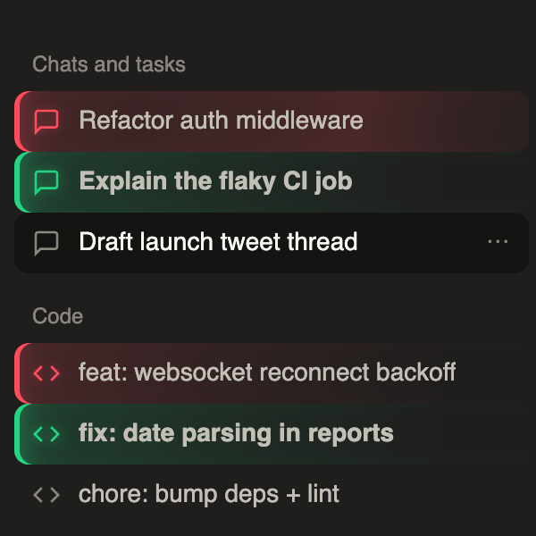

# Session Lights for Claude

A Chrome extension that color-codes sessions in the claude.ai sidebar, so you can manage many chats and Claude Code sessions at a glance.

| Color | Meaning |
| --- | --- |
| **Red** (pulsing) | Still running |
| **Green** | Finished, but you haven't looked at it yet |
| Default | Already seen, or nothing has been sent yet |

It works on both [claude.ai/code](https://claude.ai/code) (Claude Code sessions) and the regular chat UI ("Chats and tasks"). It also works on any page that lists session links, such as the recents list.




## Install

1. Clone this repo.
2. Open `chrome://extensions` and turn on **Developer mode** (top right).
3. Click **Load unpacked** and select the repo folder (the one with `manifest.json`).
4. Reload any open claude.ai tabs.

Pin the toolbar icon. Its badge shows how many sessions are running (red), or, if none are running, how many are unread (green). Click the icon to open a panel that lists the active sessions, so you can jump straight to one. The panel also has **mark all read** and a few toggles.

## How it works

The extension never calls claude.ai on its own initiative. It only watches traffic the claude.ai app already sends.

- **`src/inject.js`** runs in the page and passively reads clones of claude.ai's own network responses:
  - Chat completion streams (`POST .../chat_conversations/<id>/completion`). A chat counts as running while its stream is open. If you navigate away and the app drops the stream, the extension keeps the chat marked running and polls that conversation until the reply settles.
  - Status fields in JSON, SSE and WebSocket payloads, such as Claude Code's `session_status: "running" | "idle"` from `/v1/sessions`. When an endpoint returns statuses, the extension re-requests it every 4-12 seconds with the app's own headers, so a status change is noticed even when the app goes quiet.
- **`src/content.js`** combines those signals with on-page hints: a spinner in a sidebar row, `data-is-streaming`, or a visible Stop button. It then marks each session link's row with `data-sl-state="running|unread"`, and `src/content.css` styles those rows. The extension only sets attributes and never inserts nodes, so it can't break the app's React tree.
- **State is shared across tabs** through `chrome.storage.local`:
  - A tab that sees a session running renews a short "running" lease every 5 seconds. Other tabs and the badge treat the session as running until the lease expires.
  - A session is **unread** when its last activity (a heartbeat while running, or the moment it finished) is newer than the last time you had it open in a visible tab.
  - Sessions running when you first install the extension turn green when they finish. Older sessions stay at the default color.

## Settings (toolbar popup)

- **Chats & tasks** and **Claude Code sessions** turn coloring on or off for each kind of session.
- **Row tint** adds a soft background gradient in addition to the colored left edge.
- **Running animation** turns the breathing glow and scan line on running rows on or off. The animation is skipped automatically when your system has reduced motion enabled.
- **Debug outlines** draws a dashed outline around every row the extension recognized and logs what it detects to the page console (filter for `session-lights`). Use it if claude.ai changes its markup and something stops being colored.

## Development

```sh
npm install        # installs Puppeteer + Chrome for Testing
npm test           # end-to-end tests: real extension, mocked claude.ai
npm run icons      # re-render icons/*.png from icons/icon.svg
```

The tests load the unpacked extension into Chrome for Testing. They serve a mock claude.ai (`tests/mock-claude.mjs`) at the real `https://claude.ai` origin through request interception, so the content scripts inject exactly as they do in production. The tests cover:

- Claude Code status changes
- Chats that finish while you're elsewhere, and while you're watching
- Streams aborted by navigation
- State sync across tabs
- Persistence across reloads
- The popup and badge
- The settings toggles

Screenshots from each run are saved to `tests/artifacts/`.

## Privacy

Everything stays on your machine. The extension stores only session ids, titles, paths and timestamps in `chrome.storage.local`. It has no analytics and sends nothing to any server.
